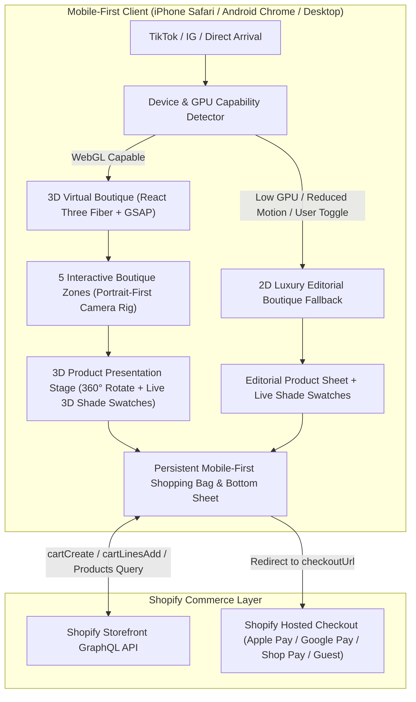

# PrettyPiggie.com — Immersive 3D Virtual Makeup Boutique
## Master Product Vision, Mobile-First Architecture & Developer Implementation Specification

---

## 1. Executive Summary & Core Mandate

### 1.1 Product Vision
Transform **PrettyPiggie.com** from a conventional e-commerce storefront into a premier, **mobile-first, immersive 3D virtual makeup boutique**. We are deliberately moving away from static Shopify product grids, predictable templates, basic navigation, and ordinary product pages.

Instead, visiting PrettyPiggie.com feels like stepping into a digitally rendered, futuristic luxury beauty flagship—complete with blush-pink architectural alcoves, polished reflective marble floors, rose-gold and champagne accents, crystal and sculptural petal chandeliers, illuminated product vitrines, interactive makeup counters, and floating 3D product showcases.

**The customer isn't simply browsing a website. They are exploring PrettyPiggie's virtual beauty world.**

> **Benchmark:** When someone arrives at PrettyPiggie from TikTok or Instagram on their iPhone or Android device, their immediate reaction should be that they have never seen an online makeup store presented this way before—and purchasing a product with one hand must be effortless.

### 1.2 Mandatory Mobile-First Engineering Mandate (Non-Negotiable)
Mobile is the **primary platform**. Desktop and tablet are enhanced adaptations built on top of the mobile-first core architecture—never the other way around.
- **Primary Traffic Source:** TikTok, Instagram Reels/Stories, and mobile social campaigns (including iOS Safari, Android Chrome, and TikTok/Instagram in-app WebViews).
- **Design From Day One for Portrait (`9:16`) & One-Handed Ergonomics:** Architecture, camera Field of View (FOV), 3D scene framing, UI controls, asset weights, and performance budgets are engineered around portrait mobile screens and thumb-zone navigation first.
- **Commerce Above All:** The 3D environment exists to increase wonder, engagement, and conversion—never to obstruct or slow down purchasing. Every device tier (including low-GPU devices via an automatic luxury 2D fallback) must offer an effortless path from product discovery to Shopify Checkout.

---

## 2. Visual Identity & Architectural Direction

Grounded in the PrettyPiggie visual reference suite (`design idea/`), the aesthetic blends high-fashion beauty editorial sophistication with playful, feminine warmth:

| Visual Pillar | Specification | Design Reference Inspiration |
|---|---|---|
| **Color Palette** | Signature PrettyPiggie Blush (`#F7C6D4`), Soft Petal Pink (`#FCEBF0`), Velvet Mauve (`#C98CA7`), Rose-Gold Metallic (`#E6A89A`), Warm Champagne (`#F5D7B8`), Obsidian Accent (`#1C1418`), Pure Warm White (`#FFFBFD`) | All 4 reference views |
| **Interior Architecture** | Curved blush walls, rounded rectangular wall alcoves framed in continuous glowing LED strips, curved glass-and-rose-gold vitrine counters, and central oval island pedestals | `Screenshot 220209`, `Screenshot 220304` |
| **Ceiling & Lighting** | Recessed oval ceiling cove with a grand crystal & rose-gold chandelier (`220209`), sculptural lotus-petal chandelier (`220304`), and futuristic curved neon/LED ceiling light tracks with starry spotlights (`220326`) | `220209`, `220304`, `220326` |
| **Flooring & Surfaces** | High-gloss reflective cream/blush marble and metallic satin-pink floors with soft distance-faded reflections; glossy lacquered pink cabinetry with dual horizontal recessed LED bands | `220209`, `220304`, `220326` |
| **3D Product Stage** | Tiered cylindrical blush-pink pedestal with glowing warm-white LED base ring, framed by metallic rose-gold halo arches, floating rose-gold geometric cubes, and glossy shade-matched floating spheres | `Screenshot 220242` |
| **Typography & HUD** | Editorial serif headings (`Cormorant Garamond` / `Playfair Display`) paired with clean geometric sans-serif UI (`Plus Jakarta Sans` / `Inter`), frosted glassmorphism overlays, and high-contrast pricing/CTAs | Luxury beauty editorial |

---

## 3. The Virtual Store Environment & Five Boutique Zones

The virtual boutique is structured as a seamless, interconnected luxury showroom with **five signature shopping destinations** (plus an Entrance Rotunda overview). Each zone is framed specifically for vertical portrait mobile viewing as well as wide desktop exploration:

### 3.1 Entrance Rotunda (Grand Overview)
- Opens with a smooth cinematic reveal beneath the recessed oval cove ceiling and crystal rose-gold chandelier.
- Prominent illuminated **PrettyPiggie** 3D signature wordmark integrated into the architecture.
- Quick-tap zone pills and interactive 3D hotspots invite the customer to swipe or tap into any department.

### 3.2 Zone 1: The Makeup Wall
- **Architecture:** Inspired by `Screenshot 220304.png`—triple rounded-corner wall alcoves outlined in warm glowing LED tubing beneath the sculptural blush petal ceiling piece.
- **Merchandising:** Multi-tiered illuminated floating shelves holding organized arrangements of **Lipsticks, Lip Glosses, Foundations, Blushes, and Eye Palettes**.
- **Mobile Interaction:** Vertical camera composition frames the full height of the illuminated wall alcoves; swiping horizontally glides along the shelves, and tapping any product zooms into its 3D Product Presentation Stage.

### 3.3 Zone 2: The Beauty Counter
- **Architecture:** Inspired by `Screenshot 220209.png` and `220304.png`—a sweeping curved rose-gold & glass display counter in the foreground with dual horizontal LED light strips along the counter lip and kickplate.
- **Merchandising:** Department-store style hero testers, daily essentials, and featured complexion & lip duos arranged on illuminated counter trays.

### 3.4 Zone 3: The PrettyPiggie Collection
- **Architecture:** Central curved oval blush-pink pedestal islands with brushed rose-gold baseboard trim and floral sculptural accents (`Screenshot 220209.png`).
- **Merchandising:** Exclusive PrettyPiggie signature collections, limited-edition sets, and monolith hero products.

### 3.5 Zone 4: The Bestsellers Display
- **Architecture:** A constellation of glowing cylindrical LED-rimmed podiums with floating rose-gold halo rings and subtle sparkle particles.
- **Merchandising:** Top-rated customer favorites with visible rating badges, quick-shade toggles, and instant "Add to Bag" triggers.

### 3.6 Zone 5: The Discovery Room
- **Architecture:** Inspired by `Screenshot 220326.png`—a futuristic high-gloss pink lounge with curved LED ceiling track lighting, starry pin spotlights, obsidian-banded neon counters, and sculptural oversized beauty brush installations.
- **Merchandising:** New arrivals, seasonal drops, viral TikTok bundles, and promotional kits.

---

## 4. Mobile-First Responsive Experience Matrix

Rather than building a desktop scene and shrinking it, the camera rig, scene graph, and UI layer adapt across three deliberately engineered form factors sharing a single Shopify commerce core:

| Dimension | Mobile (`< 768px` — Primary Target) | Tablet (`768px – 1024px`) | Desktop (`> 1024px` — Enhanced) |
|---|---|---|---|
| **Orientation & Framing** | Portrait-first (`9:16` aspect), adaptive vertical FOV (`58°–68°`), camera positioned closer to counters/alcoves so products fill vertical screen space | Balanced portrait/landscape framing (`50°–55°` FOV), wider multi-counter sightlines | Expansive architectural panorama (`42°–48°` FOV) showing ceiling chandeliers, floor reflections, and peripheral zones |
| **Navigation Controls** | Single-hand thumb-zone bottom bar; horizontal swipe gestures (`touchstart`/`touchmove`/`pointer`) to glide between zones & products; tap-to-enter departments; tap-to-focus products | Touch swipe + pinch zoom + floating zone dock + quick-view drawer | Smooth GSAP camera flights, subtle mouse-parallax camera look, orbit drag inspection, keyboard arrow/tab navigation |
| **Product Presentation** | Full-bleed upper 3D product stage (`Screenshot 220242`) + ergonomic bottom-sheet drawer for shade swatches, price, details, and sticky thumb-zone **Add to Bag** bar | Split-screen or floating glass panel beside the 3D rotating product stage | Cinema side-by-side layout: interactive 360° 3D stage on left/center with floating editorial luxury glass drawer on right |
| **Rendering Budget** | DPR capped at `[1, 1.5]`; baked/analytical lighting; simplified planar floor reflection; 25–40 sparkle particles; adaptive frame rate (`60 FPS` target, graceful step-down) | DPR `[1, 1.75]`; medium-res实时 floor reflections; 60 particles; contact shadows | DPR `[1, 2]`; high-res `MeshReflectorMaterial` marble reflections; full chandelier crystal nodes; 120 atmospheric sparkles |

---

## 5. Interactive Shopping & 3D Product Presentation Flow

### 5.1 Boutique Navigation & Wayfinding
1. **Never Lost Guarantee:** A persistent, floating top header displays the PrettyPiggie logo, current boutique zone indicator, Quick Search trigger, **3D / 2D Lite Mode toggle**, and persistent **Shopping Bag** icon with live item count badge.
2. **One-Handed Bottom Zone Dock:** Situated in the natural thumb arc at the bottom of mobile screens, allowing instant 1-tap camera transitions between *Boutique Overview*, *Makeup Wall*, *Beauty Counter*, *PrettyPiggie Collection*, *Bestsellers*, and *Discovery Room*, plus left/right swipe arrows.
3. **Interactive 3D Product Hotspots:** Every displayed product features a subtle pulsing rose-gold indicator pill showing its name and price on hover/focus, and responds to tap/click with tactile scale & glow feedback.

### 5.2 The 3D Product Presentation Stage (`Screenshot 220242.png`)
When a customer taps or clicks any product (e.g., *Velvet Kiss Sculpted Lipstick*):
1. **Cinematic Camera Transition:** The camera glides smoothly via GSAP into the dedicated **3D Product Presentation Stage** (or isolates the stage seamlessly).
2. **Hero 3D Diorama:**
   - The product is rendered at high detail atop a dual-tiered blush-pink cylindrical & rectangular podium with a glowing warm-white LED light band.
   - For lipsticks, the sculptural cap rests beside the uncapped gold-and-obsidian barrel (`Screenshot 220242.png`); for compacts, glosses, foundations, palettes, and brush sets, bespoke 3D procedural/GLB geometry renders with physically based metallic, clearcoat, and glass shaders.
   - Floating around the podium in 3D space are **glossy shade-matched spheres**, **champagne rose-gold cubes**, and **rose-gold circular halo rings**.
3. **360° Touch & Drag Rotation:** Customers can spin and inspect the 3D product freely with one finger on mobile or mouse drag on desktop.
4. **Live Shade & Variant Selection:**
   - Tapping any shade swatch (e.g., *Pretty Piggie Pink*, *Rosewood Luxe*, *Crimson Velvet*, *Champagne Nude*, *Berry Bisou*) immediately animates the 3D product's bullet/formula color AND the floating glossy 3D spheres in real time.
   - Updates price, SKU availability status, and selected variant ID.
5. **Editorial Product Details:**
   - Displays product title, subtitle, category, finish badge, star rating, description, full **Ingredients** tab, **How to Apply** guide, and **Verified Customer Reviews**.
6. **Immediate Add-to-Bag Feedback:**
   - Tapping **Add to Bag** triggers tactile visual confirmation, updates the persistent bag counter, and allows instant checkout or one-tap return to the boutique floor.

---

## 6. Mobile Performance & Adaptive Rendering Architecture (Non-Negotiable)

To guarantee fast loading from TikTok/Instagram links and smooth 60 FPS interaction on everyday smartphones:

### 6.1 Device Capability Detection & Quality Tiers
On initialization, the **Adaptive Performance Engine** evaluates:
- WebGL2 / WebGL1 context availability and GPU renderer string (`WEBGL_debug_renderer_info`).
- `navigator.deviceMemory` and `navigator.hardwareConcurrency`.
- `window.matchMedia('(prefers-reduced-motion: reduce)')`.
- Network connection hints (`navigator.connection?.saveData`, `effectiveType`).
- Real-time frame duration rolling average via `<PerformanceMonitor />` inside React Three Fiber.

Based on these signals, the engine assigns and dynamically adjusts between four rendering modes:
1. **`high` (Capable Desktop / Flagship Mobile GPUs):** Full reflections, chandelier crystal arrays, animated floating geometry, DPR up to `1.5` (mobile) / `2.0` (desktop).
2. **`medium` (Standard iPhone / Mid-Range Android):** Optimized material shaders, reduced particle count, lower-resolution reflection buffers, DPR `1.0–1.25`.
3. **`low` (Budget Mobile / Low Battery / High Frame Time):** Disables real-time floor reflection passes in favor of baked gradient roughness, pauses idle ambient animations, DPR `1.0`.
4. **`fallback-2d` (Unsupported WebGL, Save-Data, Reduced Motion, or User Toggle):** Automatically renders the **2D Luxury Editorial Boutique Fallback** without loading or executing heavy WebGL loops.

### 6.2 Strict Performance Guardrails
- **Visibility Lifecycle Management:** An automatic `document.visibilityState` listener pauses the 3D render loop (`frameloop="never"` or clock pause) whenever the user switches tabs or backgrounds the browser.
- **Draco / Meshopt Compressed GLB Pipeline & Procedural Instancing:** Shared architectural materials and instanced product geometries keep initial JavaScript + 3D payload compact and eliminate multi-megabyte blocking downloads on cellular networks.
- **Zero-Blocking Commerce UI:** The HTML/React HUD, Search, Product Drawer, Cart Drawer, and Checkout run in a lightweight DOM layer decoupled from the WebGL canvas thread.

---

## 7. Luxury 2D Mobile & Accessibility Fallback

If a device lacks WebGL support, experiences severe GPU throttling, has `prefers-reduced-motion` enabled, or if a shopper taps the **"2D Boutique"** quick-switch in the header:
- The application seamlessly presents a **Luxury Editorial 2D Boutique Experience** styled in PrettyPiggie's signature blush-pink, rose-gold, and glassmorphic design language.
- Showcases the actual architectural boutique imagery (`design idea/` scenes), interactive department tabs, high-contrast product cards, visual shade swatch selectors, product reviews/ingredients modal, and full cart & Shopify checkout functionality.
- **Rule:** A 3D rendering limitation can *never* prevent a customer from browsing shades or completing a purchase.

---

## 8. Technology Stack & System Architecture

| Layer | Technology | Role in PrettyPiggie |
|---|---|---|
| **Frontend Framework** | **Next.js (App Router) + React + TypeScript** | SSR/SSG shell, fast initial HTML paint for social traffic, routing, and state orchestration |
| **3D Engine** | **Three.js + React Three Fiber (`@react-three/fiber`) + `@react-three/drei`** | Declarative 3D virtual boutique scene graph, PBR rose-gold/marble/lacquer materials, reflective floor, and 3D product stage |
| **Camera & UI Animation** | **GSAP (`gsap`)** | Silky camera position/target interpolations between boutique zones and 3D product inspection stages |
| **Styling & HUD** | **Tailwind CSS + Custom CSS Variables** | Mobile-first thumb-zone overlays, frosted glassmorphism cards, responsive bottom sheets, and 2D luxury fallback |
| **Commerce Backend** | **Shopify Storefront GraphQL API (`2024-10`)** | Live product catalogue, collections, variant pricing/inventory, and headless cart mutations (`cartCreate`, `cartLinesAdd`, `checkoutUrl`) |
| **Checkout** | **Shopify Hosted Checkout + Mobile Express Pay** | Seamless redirect to `checkoutUrl` supporting Shop Pay, Apple Pay, Google Pay, and guest card checkout with zero mandatory account creation |
| **Deployment** | **Vercel** | Global Edge CDN, automatic WebP/AVIF image optimization, and Core Web Vitals telemetry |

---

## 9. Integrated Mobile-First Development Phases

All four development phases incorporate mobile-first architecture, portrait 3D layout, and conversion optimization as core deliverables from day one:

### Phase 1 — Mobile-First Visual Foundation & 3D Boutique Architecture
- Establish PrettyPiggie's signature blush-pink, rose-gold, and glossy marble visual identity (`design idea/` reference alignment).
- Engineer the **Adaptive Capability Detector** and responsive portrait-first (`9:16`) camera rig before expanding to tablet and desktop FOVs.
- Build the 3D Virtual Boutique environment:
  - Entrance Rotunda with oval cove ceiling & crystal rose-gold chandelier (`Screenshot 220209`).
  - The Makeup Wall with rounded LED-trimmed alcoves, floating illuminated shelves, and petal ceiling fixture (`Screenshot 220304`).
  - The Beauty Counter with curved rose-gold glass vitrines and dual LED strips (`Screenshot 220209`, `220304`).
  - The PrettyPiggie Collection central oval island pedestals.
  - The Bestsellers Display glowing podiums.
  - The Discovery Room with futuristic curved LED ceiling tracks and sculptural brush displays (`Screenshot 220326`).
- Implement touch swipe navigation, one-handed bottom thumb-zone dock, and smooth GSAP camera transitions.

### Phase 2 — Interactive 3D Store, Product Stage & 2D Luxury Fallback
- Build clickable/tappable 3D product displays across all five boutique zones with hover/tap illumination.
- Build the **3D Product Presentation Stage** (`Screenshot 220242`): LED-rimmed pink podium, floating rose-gold halo arches, rotating rose-gold cubes, and glossy spheres that change color with shade selection.
- Implement 360-degree touch/drag product rotation and real-time 3D shade swatch material updates.
- Build the mobile bottom-sheet product drawer with pricing, ingredients, reviews, and sticky thumb-zone **Add to Bag** CTA.
- Build the complete **2D Luxury Editorial Fallback Mode** with instant automatic activation and manual header toggle.

### Phase 3 — Shopify Storefront Integration & Mobile Conversion Flow
- Implement the Shopify Storefront GraphQL API service (`products`, `collections`, `cartCreate`, `cartLinesAdd`, `cartLinesUpdate`, `cartLinesRemove`) with seamless fallback to the curated PrettyPiggie product catalogue when operating in demo/preview mode.
- Synchronize variant pricing, shade hex metadata, inventory status, and SKU identifiers.
- Implement persistent local + remote cart synchronization, free-shipping progress bar, shipping/returns transparency badges, and frictionless guest checkout via Shopify Checkout (supporting Apple Pay, Google Pay, and Shop Pay).

### Phase 4 — Performance Polish, Device Telemetry & Verification
- Integrate real-time FPS telemetry, adaptive DPR scaling, and background-tab render pausing (`document.visibilityState`).
- Verify accessibility: keyboard navigation (`Tab`, `ArrowLeft`/`ArrowRight`, `Escape`), ARIA labels, screen-reader product summaries, and `prefers-reduced-motion` compliance.
- Validate across mobile portrait viewports (`375x812` iPhone, `390x844` iPhone Pro, `412x915` Android), tablet (`768x1024`), and desktop (`1440x900`), confirming zero friction from initial landing to checkout.

---

## 10. Mobile & Cross-Platform Acceptance Criteria Checklist

- [x] **Portrait-First Mobile Boutique:** Opens directly into a vertical-optimized 3D blush-pink luxury showroom on iPhone Safari and Android Chrome.
- [x] **One-Handed Thumb Ergonomics:** Zone navigation dock, swipe gestures, shade selection swatches, and "Add to Bag" button sit comfortably within the natural lower thumb zone.
- [x] **Five Signature Boutique Destinations:** *The Makeup Wall*, *The Beauty Counter*, *The PrettyPiggie Collection*, *The Bestsellers Display*, and *The Discovery Room* are each distinct, navigable 3D spaces.
- [x] **3D Product Presentation Diorama (`Screenshot 220242`):** Selecting any product transitions to the glowing podium with floating rose-gold rings, cubes, spheres, 360° touch rotation, and real-time 3D shade color changes.
- [x] **Non-Negotiable Mobile Performance:** Adaptive DPR, GPU tier detection, paused rendering when hidden, and automatic degradation under load.
- [x] **Automatic & Toggleable 2D Fallback:** Full shopping capability (branding, photos, shades, reviews, cart, checkout) preserved in a fast 2D luxury interface whenever 3D is unsupported or toggled off.
- [x] **Conversion-Optimized Commerce:** Persistent shopping bag, transparent shipping/returns info, guest checkout without mandatory registration, and Shopify Storefront API integration.
